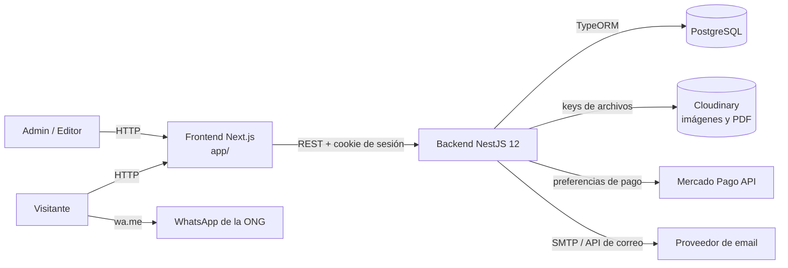
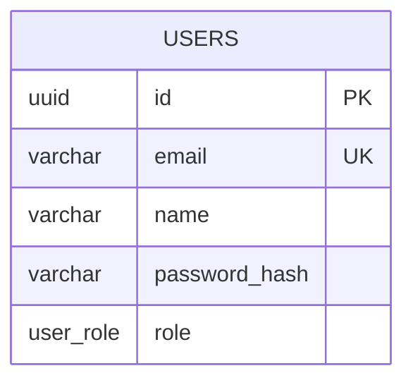
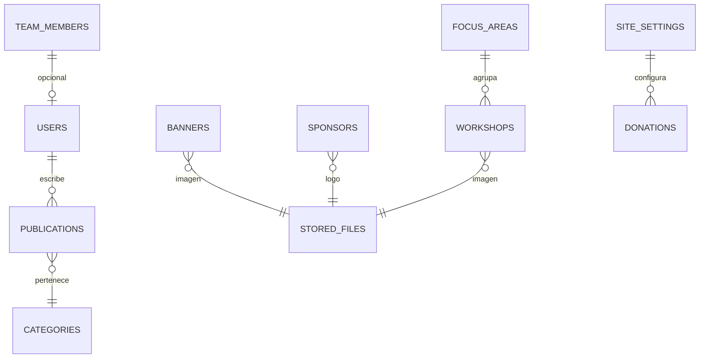

# Arquitectura de Manos en Acción

> Documento de referencia para agentes. Describe la arquitectura **actual** y la **propuesta** para los módulos pendientes. Lo que está marcado como propuesto no existe todavía en el código.

## 1. Vista general



- El frontend es una aplicación Next.js (App Router) y el backend una API REST NestJS.
- Los archivos binarios (imágenes y PDF) **no** se guardan en PostgreSQL: en la base se persiste solo una clave/URL. Cloudinary es el proveedor de storage definido (sección 7).
- La UI pública y el panel administrativo comparten frontend; el backend mantiene sesiones persistentes en PostgreSQL y envía una cookie HttpOnly al navegador. No hay JWT Bearer ni tokens en el cliente.

## 2. Backend

### Módulos actuales

| Módulo | Responsabilidad | Archivos clave |
|---|---|---|
| `AppModule` | Configuración global, TypeORM, autenticación, autorización, pipe de validación | `src/app.module.ts` |
| `UsersModule` | Entidad `User`, CRUD de usuarios (alta de editores), seed | `src/users/`, `src/seeds/users.seed.ts` |
| `TeamMembersModule` | Entidad `TeamMember`, CRUD con foto multipart y baja física | `src/team/` |
| `WorkshopsModule` | Entidades `FocusArea` y `Workshop`, CRUD de ejes/talleres con imagen y PDF, agrupación pública | `src/workshops/`, `src/schemas/workshops.schemas.ts` |
| `StorageModule` | `StorageService` + adaptador de Cloudinary para imágenes y PDF `raw` | `src/storage/` |
| `AuthModule` | Login, logout, `/me`, cambio de contraseña, proveedor de sesión por cookie y store TypeORM | `src/auth/` |
| `Authorization` | Policies `ContentPolicy` y `AdminPolicy` | `src/authorization/` |
| `Schemas` | Esquemas Zod de env/auth/users/team/workshops y tipos derivados | `src/schemas/` |
| `Migrations` | DDL versionado de PostgreSQL | `src/migrations/` |

### Ciclo de una request

```
Request
  → StandardSchemaValidationPipe (Zod, registrado como APP_PIPE)
  → Guard de autenticación por sesión/cookie de @nestjs/authentication (salvo @Public())
  → @Can(Policy, 'acción') de @nestjs/authorization (salvo rutas públicas)
  → Controller (delgado: delega al service)
  → Service (reglas de negocio, TypeORM, errores HTTP)
  → Repository/TypeORM → PostgreSQL
  → Respuesta (DTO público, sin campos sensibles)
```

Reglas derivadas de este flujo:

- Ninguna ruta nueva queda sin `@Public()` o `@Can(...)`.
- La validación es declarativa con esquemas Zod; no se valida a mano dentro del service salvo reglas de negocio.
- Los controllers no contienen lógica de negocio; los services no lanzan respuestas HTTP directamente sino excepciones de Nest (`BadRequestException`, `UnauthorizedException`, `ForbiddenException`, `NotFoundException`, `ConflictException`, etc.).
- Los DTO de entrada salen de `z.infer` y viven en `src/schemas/*.schemas.ts`.
- Las respuestas públicas se construyen con helpers explícitos (patrón actual: `toPublicUser`), nunca con `return entity` directo si la entidad tiene campos sensibles.

### Autorización

| Política | Método | Quién puede |
|---|---|---|
| `ContentPolicy` | `manage` | `admin` y `editor` |
| `AdminPolicy` | `manageEditors` | `admin` |
| `AdminPolicy` | `manageEditor` | `admin`, sobre un `editor` distinto de sí mismo |
| `AdminPolicy` | `manageDonationCredentials` | `admin` (declarado, sin endpoint aún) |
| `AdminPolicy` | `manageContactEmails` | `admin` (declarado, sin endpoint aún) |
| `AdminPolicy` | `manageSiteSettings` | `admin` (declarado, sin endpoint aún) |

Los métodos declarados pero sin uso son el punto de extensión natural para RF-009, RF-011, RF-012 y RF-014/015.

### Datos y migraciones

- La entidad real es solo `User` (`users`): UUID, email único normalizado, name, `password_hash` (`select: false`) y enum `user_role` (`editor`, `admin`).
- El tipo enum de PostgreSQL se crea en la migración (`CREATE TYPE "user_role"`). Los enums nuevos deben crearse de forma similar en su propia migración.
- `synchronize: false`: el esquema solo cambia por migración. Cada migración nueva se agrega al array `migrations` de `app.module.ts`; no se agrega automáticamente aunque `autoLoadEntities` cargue las entidades.
- En `NODE_ENV=test` se usa `TEST_DATABASE_URL` y `dropSchema: true`.
- El seed de usuarios corre al iniciar el módulo; es idempotente por email.

### Configuración

`envSchema` (Zod) valida al arrancar: `NODE_ENV`, `PORT`, `CORS_ORIGIN`, `SESSION_IDLE_TTL` (`1d`), `SESSION_ABSOLUTE_TTL` (`7d`), `DATABASE_URL`/`TEST_DATABASE_URL` según entorno, credenciales de seed y de Cloudinary. Ya no hay variables JWT. `.env.example` enumera los nombres; los valores reales viven solo en `.env` (ignoreado) o en el entorno del servidor. La cookie es `__Host-sid` en producción (`Secure`, `SameSite=Lax`) y `sid` en tests.

**Distinción importante para los RF pendientes:** hay datos que la ONG debe poder cambiar desde el panel sin tocar código (teléfono de WhatsApp, datos bancarios, enlaces a Donar Online/Help, emails de contacto y credenciales de Mercado Pago). Esos datos no son configuración de arranque: son **datos del sitio**. Recomendación: guardarlos en una tabla `site_settings` con acceso restringido por `AdminPolicy.manageSiteSettings`; mantener secretos de pago en variables de entorno si no se implementa cifrado. Ver sección 7.

## 3. Frontend

- `app/layout.tsx`: layout raíz, fuentes Geist, metadata e idioma (`lang="en"` hoy; debe pasar a `es`).
- `app/page.tsx`: homepage del template; reemplazar por la landing de la ONG.
- `app/globals.css`: Tailwind 4 con tokens `--background`/`--foreground`.
- `next.config.ts`: `cacheComponents`, `partialPrefetching`, `experimental.agentFeedback` y loader de Tailwind para Turbopack.
- Alias `@/*` → raíz de `frontend/`.

Puntos de extensión previstos (no creados todavía):

```
frontend/app/
├── (publico)/        landing, noticias, talleres, equipo, aliados, donaciones, contacto
├── admin/            panel con rutas protegidas por rol
├── actions|lib/api/  cliente HTTP tipado contra la API
└── components/       carrusel, tarjetas, formularios, widget de WhatsApp
```

Antes de crear rutas o usar APIs de Next, leer `frontend/node_modules/next/dist/docs/`. `frontend/AGENTS.md` es autogenerado y no se edita manualmente.

## 4. Modelo de datos

### Actual (implementado)



### Propuesto (según `diagramaDeEntidades.puml` y los RF)



Tablas/entidades a crear, con campos mínimos derivados de los RF (nombres definitivos se ajustan al implementar):

| Entidad | Campos previstos | RF |
|---|---|---|
| `publications` (noticias) | título, subtítulo, cuerpo, categoría, fecha de publicación, `image_key`, autor (`user_id`) | RF-001 |
| `categories` / tag | nombre normalizado (lista **a definir con la ONG**) | RF-001 |
| `team_members` | nombre, apellido, rol/cargo, biografía, `image_key` (baja física: se borra fila e imagen) | RF-002 |
| `focus_areas` (ejes de acción) | `name`, descripción, `image_key` | RF-003 |
| `workshops` | título, descripción, `focus_area_id`, `image_key`, `pdf_key`/`pdf_name` opcionales | RF-003, RF-004 |
| `sponsors` | nombre, `logo_key`, URL opcional, activo | RF-005 |
| `banners` | `image_key`, orden, activo | RF-006 |
| `site_settings` | claves/valores: email de contacto, WhatsApp, CBU/CVU, alias, banco, titular, CUIT, URLs de Donar Online/Help, credenciales MP | RF-009, RF-011…RF-013 |
| `donations` | monto, moneda, estado, `preference_id`, email del donante, fecha | RF-008, RF-011 |
| `contact_messages` | tipo (empresarial/voluntario), email, asunto, cuerpo, estado de envío | RF-014, RF-015 |

Los archivos/keys siguen el modelo del diagrama: `STORED_FILES` con `key` (equivalente al `public_id` de Cloudinary) y cada entidad guarda la clave, no el binario. La URL de imágenes se obtiene con `getUrl` y la de PDF con `getPdfUrl`.

## 5. Almacenamiento de archivos

- Cloudinary es el proveedor elegido para imágenes y PDF. Ya está instalado el SDK `cloudinary` (`^2.11.0`) y `@types/multer` (`^2.3.0`, agregado a `compilerOptions.types`).
- Implementación real: `StorageService` valida MIME por contenido, extensión, tamaño y ausencia de archivo; `StorageAdapter` (token `STORAGE_ADAPTER`) encapsula el SDK. `CloudinaryStorageAdapter` sube por data URI base64, guarda el `public_id` como `key` y construye la URL segura. Imágenes: `uploadImage(file, rule)` → `{ key, url }`, `getUrl(key, rule)`. PDF: `uploadPdf(file, mime, rule)` → `{ key, url }` con `resource_type: 'raw'`, `getPdfUrl(key, rule, name?)` con flag `attachment`. Los flujos de imagen y PDF son independientes dentro del mismo adaptador.
- `delete(key, resourceType)` usa `destroy` con `invalidate: true` y trata `not found` como éxito; `resourceType` vale `'image'` por defecto o `'raw'` para PDF. `StorageService.delete()` es best-effort para limpiezas de rollback; `deleteRequired()` reintenta 3 veces y traduce el fallo a `502` para borrados visibles para el usuario.
- Las entidades guardan solo la clave (`image_key`, `pdf_key`), nunca el binario ni credenciales. La URL se deriva al responder; `pdf_name` guarda el nombre visible del adjunto (RF-004).
- RF-002, RF-003 y RF-004 usan baja física sincrónica, sin columna `active` ni job/outbox: `DELETE` purga Cloudinary (imagen y, si existe, PDF `raw`) y luego elimina la fila. Si falla la purga no se toca PostgreSQL; si falla PostgreSQL después de la purga, queda una fila con clave rota hasta reintentar el `DELETE`. `DELETE /focus-areas/:id` responde `409` antes de purgar si existen talleres que apuntan al eje (FK `ON DELETE RESTRICT`).
- Los PDF se envían en el mismo `multipart/form-data` del CRUD de talleres, en el campo `pdf`, con `FileFieldsInterceptor` (`image` + `pdf`, un archivo por campo). No hay endpoint `/uploads/pdf` ni tabla `attachments`: el diagrama prevalece con `pdf_key`/`pdf_name` nullable en `workshops`.
- Reglas (RF-007): `TEAM_IMAGE_RULE`, `WORKSHOP_IMAGE_RULE` y `FOCUS_AREA_IMAGE_RULE` usan JPG/PNG/WebP, `≤5MiB`, carpetas dedicadas y transformación `1000x1000` con `crop: fill` y `gravity: face`. `PDF_RULE` usa `application/pdf`, bytes `%PDF-`, extensión `.pdf`, `≤10MiB` y carpeta `workshops/pdfs`. Las respuestas de error son `415` para tipo no permitido o bytes que no son `%PDF-`, y `400` para extensión o peso inválidos. Falta generalizar a banner, logo, noticia y sponsor; los textos de ayuda del formulario deben usar esas mismas reglas.
- Las credenciales de Cloudinary (`CLOUDINARY_CLOUD_NAME`, `CLOUDINARY_API_KEY`, `CLOUDINARY_API_SECRET`, `CLOUDINARY_FOLDER`) se leen de variables de entorno; nunca se escriben en la BD, logs ni documentación. En tests `NODE_ENV=test` son opcionales y el adaptador se mockea. Hoy `CLOUDINARY_FOLDER` se valida pero no se usa: la carpeta efectiva de equipo es `team-members` (`TEAM_IMAGE_RULE.folder`).

## 6. Integraciones externas

| Integración | RF | Estado | Notas de arquitectura |
|---|---|---|---|
| Mercado Pago Checkout API | RF-011 | No implementado | El backend crea la preferencia con credenciales vigentes y devuelve `init_point`. URLs `success`/`failure`/`pending` deben apuntar al frontend. Errores de credenciales/comunicación → `502`. |
| Transferencia / Donar Online / Help | RF-012 | No implementado | Datos editables desde `site_settings`; enlaces con `target="_blank"` y `rel="noopener noreferrer"`. |
| WhatsApp `wa.me` | RF-013 | No implementado | Número con código de país desde `site_settings`; widget solo en vistas públicas. |
| SMTP / API de correo | RF-014, RF-015 | No implementado | `Reply-To` = correo del remitente; asunto fijo "Postulante a Voluntariado" para RF-015. Fallo del proveedor → `502`/`500`. |

## 7. Decisiones tomadas y decisiones abiertas

### Tomadas (no volver a discutir salvo que el equipo lo pida)

- NestJS 12 + ESM con imports `.js`; Zod + `StandardSchemaValidationPipe`; TypeORM con migraciones; sesiones persistentes con cookie HttpOnly y CSRF por origen; policies de Nest; Swagger decorado en español; Vitest para tests.
- React/Next en el frontend; Tailwind 4 con Turbopack.
- Cloudinary como proveedor de storage de archivos; los binarios quedan fuera de PostgreSQL y en BD se guarda solo la clave/URL.
- Para equipo, la foto se envía en el mismo `multipart/form-data` del CRUD (`image`); no hay endpoint separado de subida. Supuesto documentado: retrato `1:1`, JPG/PNG/WebP, `≤5MiB`.
- Para ejes y talleres, imagen y PDF viajan juntos en el mismo multipart (`image` y `pdf`), pero se validan y almacenan en flujos separados del `StorageService`. El PDF se guarda como `raw`; `pdf_key`/`pdf_name` son opcionales y `getPdfUrl` devuelve un enlace de descarga.
- `FocusArea` tiene `name`, `description` e `image`, y agrupa muchos talleres; `Workshop` pertenece a un solo eje (`focus_area_id` obligatorio). Se agregó `name` aunque el diagrama original no lo listaba, porque los RF y el selector lo requieren.
- Los talleres no tienen campo `status` ni `active`: no se persiste ni se expone ningún estado. La baja es física con purge de imagen/PDF usando `DELETE`; no existe historial de estados activo/inactivo.
- Roles: solo `admin` y `editor`. El alta pública de usuarios no existe.

### Abiertas (preguntar antes de asumir)

| Tema | Por qué importa | Recomendación provisoria |
|---|---|---|
| Categorías de noticias | RF-001 exige filtro por categoría/tag y el diagrama dice "consultar a la ONG". | Empezar con un catálogo simple editable por admin; no hardcodear una lista larga. |
| Modelo de `Donation` | El diagrama dice "definir todos juntos más tarde". | Registrar al menos monto, estado y `preference_id`; no guardar datos de tarjeta. |
| Credenciales de Mercado Pago | RF-009 dice que el admin debe poder actualizarlas; RF-011 las usa. | Datos no sensibles en `site_settings`; secretos en variables de entorno de la plataforma de deploy, salvo que se implemente cifrado en BD. |
| Datos bancarios y URLs | RF-012 exige edición sin tocar código. | `site_settings`, validados con Zod y con copia al portapapeles en el frontend. |
| Entorno de despliegue | No hay definido hosting ni dominio. | Definir antes de cerrar F5; el runbook de operación depende de esto. |

## 8. Convenio de nombres para lo nuevo

- Tablas en `snake_case` plural (`team_members`, `focus_areas`).
- Entidades TypeScript en `PascalCase` singular (`TeamMember`, `FocusArea`) en `src/<modulo>/entities/`.
- Esquemas Zod en `src/schemas/<modulo>.schemas.ts` con sufijo `Schema` y tipos `Dto`.
- Decoradores de Swagger en `src/<modulo>/decorators/<modulo>-swagger.decorator.ts`.
- Migraciones con timestamp `YYYYMMDDHHmmss-Nombre.ts`, exportando `Nombre<timestamp>` e implementando `MigrationInterface`.
- Rutas REST en plural y kebab-case cuando haga falta: `/news`, `/team-members`, `/workshops`, `/focus-areas`, `/sponsors`, `/banners`, `/site-settings`, `/donations`, `/contact`.
